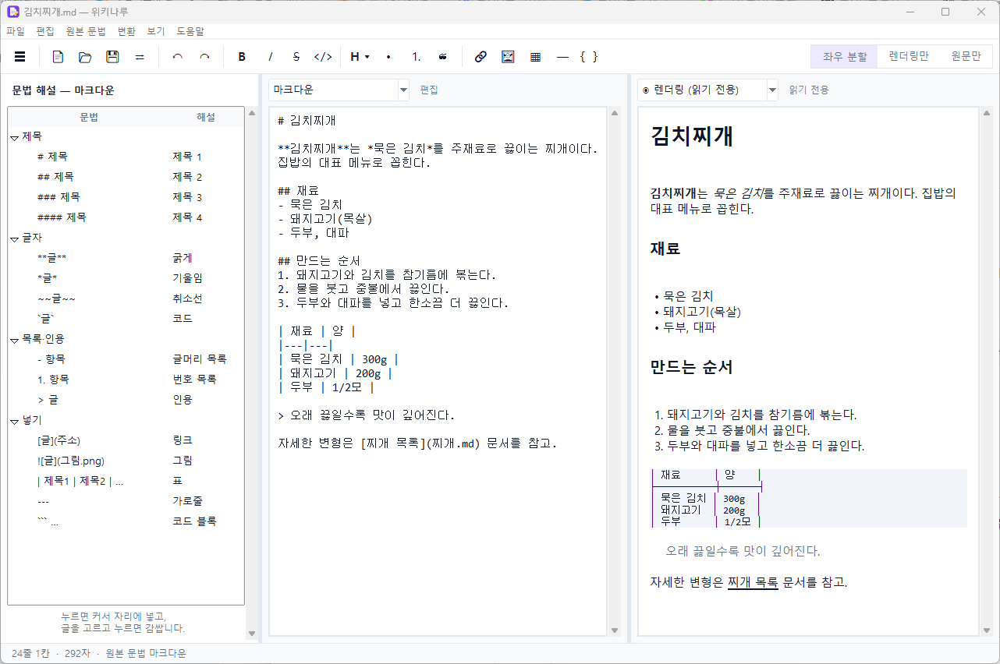
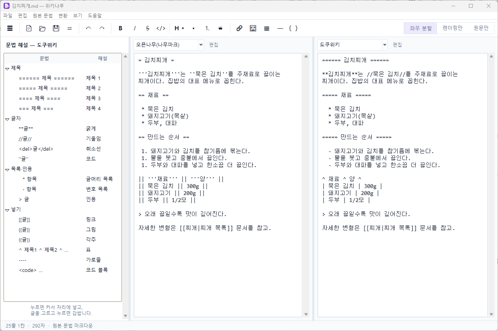
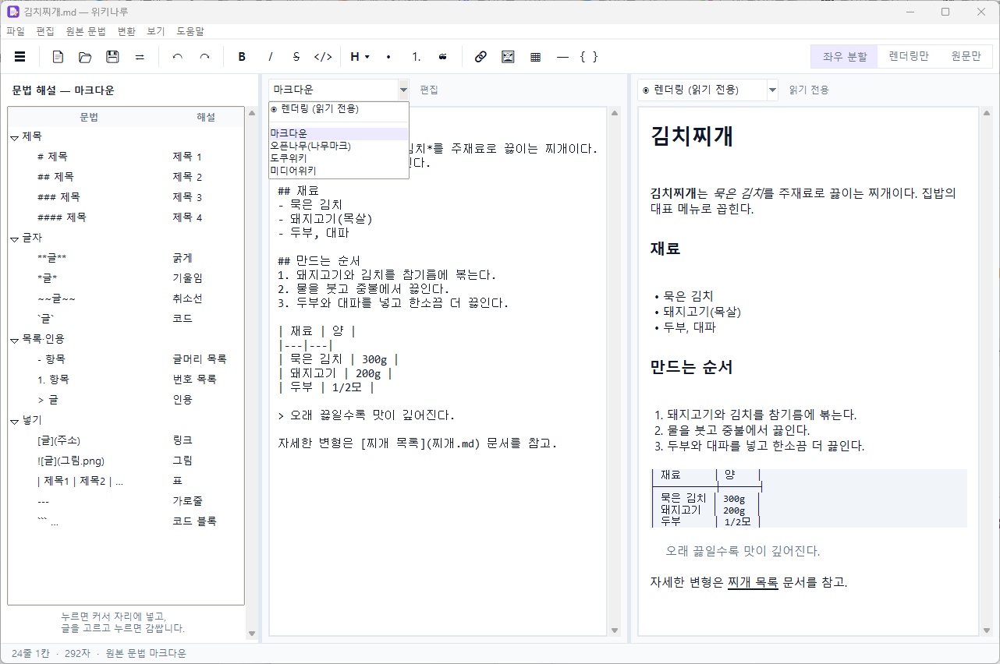
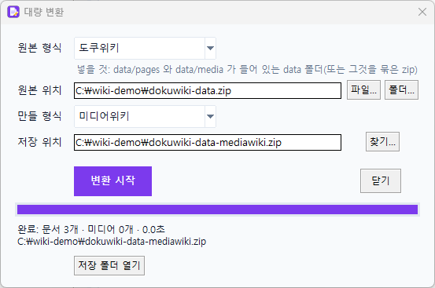

# 위키나루

도쿠위키 · 미디어위키 · 오픈나무(나무마크) · 마크다운 문법으로 쓰고, 서로 바꾸고, 위키 데이터를 통째로 옮기는 편집기입니다.
**내 컴퓨터 안에서만** 돌고, 올린 파일은 어디로도 보내지 않습니다. 파이썬 표준 라이브러리만 씁니다(설치할 것 없음, Python 3.9 이상).

## 받는 법

[**Releases**](https://github.com/iamtalker/wiki-naru/releases/latest) 에서 `WikiNaru-vX.Y.Z-windows.exe` 를 받아 실행합니다(파이썬이 없어도 됩니다).
코드 서명이 없어 윈도우 SmartScreen 경고가 뜰 수 있습니다("추가 정보 → 실행"). 소스로 쓰려면 `python src/위키나루.pyw` (Python 3.9 이상, 표준 라이브러리만 사용).

### (선택) 원본 위키 변환기 — 옵션
위키나루가 되기 전의 **원래 위키 변환기(웹 판)** 를 `wiki-converter-original-web.zip` 으로 **모든 릴리즈에 선택 항목으로 함께 제공**합니다.
위키나루만 쓰신다면 받지 않으셔도 됩니다. 압축을 풀어 `위키변환기.bat`(또는 `python app.py`)로 실행하며, 이 파일의 코드는 당시 MIT 라이선스입니다.

## 화면

**쓰면서 바로 확인** — 왼쪽 마크다운, 오른쪽 렌더링


**같은 문서를 두 문법으로 실시간 변환** — 왼쪽 오픈나무, 오른쪽 도쿠위키(어느 쪽에서 써도 반대편이 따라옵니다)


**패널마다 드롭박스로 선택** — 렌더링 / 마크다운 / 오픈나무 / 도쿠위키 / 미디어위키


**대량 변환** — 위키 데이터를 통째로 다른 형식으로


## 쓰는 법

### 편집기 (창 프로그램)
`위키나루.exe` 를 더블클릭합니다(브라우저를 쓰지 않는 독립 창, 파이썬이 없어도 됩니다). 소스에서는 `src/위키나루.pyw` 를 실행하세요. exe 는 `python src/tools/build_exe.py` 로 만듭니다(PyInstaller 필요, 아이콘은 `python src/tools/make_icon.py`).
**듀얼 패널**: 왼쪽·오른쪽 패널 위에 각각 드롭박스(마크다운 / 렌더링 / 오픈나무 / 도쿠위키 / 미디어위키)가 있습니다. 문법을 고른 패널은 편집할 수 있고, 렌더링을 고른 패널은 읽기 전용 모양 보기입니다. 한쪽에서 쓰면 반대편이 150ms 안에 따라옵니다.
예) 왼쪽 마크다운 + 오른쪽 렌더링 = 쓰면서 바로 보기 · 왼쪽 렌더링 + 오른쪽 마크다운 = 오른쪽에서 편집 · 왼쪽 오픈나무 + 오른쪽 마크다운 = 실시간 상호 변환(어느 쪽에서 써도 됩니다). **변환** 메뉴에서는 쓰던 글을 다른 문법으로 바꿔 복사하거나(이 문서는 그대로) 바꿔서 파일로 저장합니다.
- **보기 모드**(툴바 오른쪽 토글 또는 보기 메뉴): **좌우 분할**(두 패널) · **렌더링만**(렌더링 결과를 크게) · **원문만**(원래 문법만 크게, 집중 편집).
- 위쪽 아이콘 막대: 새 문서·열기·저장, 되돌리기, **B**(굵게, Ctrl+B)·*I*(기울임, Ctrl+I)·S(취소선)·코드, 제목 크기, 목록·번호·인용, 링크(Ctrl+K)·그림·표·가로줄·코드 블록. 지금 고른 문법의 표기(`**굵게**`, `'''굵게'''`, `[[링크]]` 등)로 들어가고, 이미 입힌 서식은 한 번 더 누르면 벗겨집니다. 오른쪽에서 문법을 고르고 미리보기를 켜고 끌 수 있습니다.
- 맨 왼쪽 **문법 해설 사이드바**: 지금 편집 중인 패널의 문법으로 서식(제목·굵게·목록·링크·표 …)을 `문법 → 해설` 순서로 나열합니다. 누르면 커서 자리에 넣고(빈 줄이면 표시와 '제목'·'항목' 같은 자리 글을 넣고 골라 둡니다), 글을 고르고 누르면 감쌉니다. 아이콘 막대의 서식 버튼도 같은 패널에 적용됩니다. 보기 메뉴의 **문법 해설 사이드바**나 툴바 맨 왼쪽 ☰ 로 켜고 끄며, 설정은 사용자 폴더의 `.wiki-naru.json` 에 기억합니다.
- **선택은 기억됩니다:** 두 패널의 드롭박스 선택(예: 왼쪽 마크다운 / 오른쪽 렌더링), 보기 모드, 사이드바, 글자 크기, 창 크기·위치를 껐다 켜도 그대로 불러옵니다(사용자 폴더의 `.wiki-naru.json`). 파일을 열어도 고른 선택은 바뀌지 않습니다.
- 드롭박스에서 **렌더링**은 맨 위에 `◉` 표시와 "읽기 전용" 글자로 구분돼 있고(색은 쓰지 않습니다), 두 패널의 목록 순서가 같습니다.
- 저장은 파일 자신의 문법으로 합니다(열 때 짐작, 인코딩·줄바꿈도 그대로). 문법을 잘못 짐작했으면 **원본 문법** 메뉴에서 글은 그대로 두고 읽는 문법만 바꿀 수 있습니다.
- 링크를 누르면 같은 폴더의 그 문서가 열리고, 바깥 주소는 기본 브라우저로 열립니다.
- **그림:** 같은 폴더의 그림 파일(png·gif·jpg·bmp)과 `` 같은 **외부 주소 그림**이 렌더링에 보입니다. 외부 그림은 그 그림 주소에만 접속해 내려받고(최대 20MB, 폭 520px 로 줄여 임시 폴더에 보관) 문서 내용은 어디로도 보내지 않습니다. 인터넷에 접속하지 않으려면 **보기 → 외부 이미지 불러오기**를 끄세요(선택은 기억됩니다). jpg 등은 윈도 그림 라이브러리(GDI+)로 읽습니다.
- `.md` 를 더블클릭으로 열고 싶으면 탐색기에서 `.md` 파일 → 연결 프로그램 → 다른 앱 선택 → `위키나루.exe` → **항상** 을 고르세요. 프로그램이 직접 레지스트리에 등록하는 기능은 없습니다(exe 를 옮긴 뒤 옛 경로가 남는 문제 때문에 뺐습니다). 예전 판의 '열기 방법에 등록'으로 남은 항목은 시작할 때 자동으로 지웁니다(우리가 만든 항목만, 위키나루를 기본 앱으로 지정해 쓰는 중이면 지우지 않습니다. 환경변수 `WIKINARU_NO_REGISTRY_CLEANUP=1` 이면 건너뜁니다). exe 를 옮긴 뒤에는 같은 방법으로 한 번 더 고르세요.
- **변환 → 대량 변환…**(툴바 ⇄): 위키 데이터(zip·폴더·파일)를 통째로 다른 위키 형식의 zip 으로 바꿉니다. 아래 '대량 변환' 표와 같은 규칙이고, 변환은 백그라운드에서 돌아 창이 멈추지 않습니다.
- 큰 글(4만 자 이상)은 변환을 별도 스레드에서 해서 타이핑이 끊기지 않습니다. 입력은 150ms 디바운스로 반대편 패널에 반영합니다.
- 명령줄: `pythonw src/위키나루.pyw 문서.md`. 한글 윈도 메모장에서 쓰던 cp949 파일도 열고, 저장할 때 원래 인코딩과 줄바꿈(CRLF)을 지킵니다.

### 1. 문서 변환
위키 문서를 붙여넣으면 고른 문법으로 바꿔 줍니다. 원본 형식은 자동으로 짐작하고(틀리면 직접 고르기), 옮기지 못해 원문으로 남긴 곳의 수를 알려 줍니다.

### 2. 대량 변환
위키 데이터를 통째로 넣으면 다른 위키가 받는 형식의 zip 으로 만들어 줍니다.

| 입력(원본) | 이렇게 넣으세요 |
|---|---|
| 도쿠위키 | `data/pages`, `data/media` 가 들어 있는 `data` 폴더를 zip 으로 (폴더 그대로도 됨) |
| 미디어위키 | `Special:Export` 등으로 받은 XML(`.xml`, `.xml.gz`). 이미지 폴더를 같이 zip 에 넣으면 이미지도 옮김 |
| 오픈나무 | `data.db` 파일 (이미지 폴더와 함께 zip 으로 묶어도 됨) |
| 마크다운 | `.md` 파일들이 든 zip 또는 폴더 |

| 출력 | 안에 들어가는 것 |
|---|---|
| 도쿠위키 | `data/pages/…`, `data/media/…` |
| 미디어위키 | `mediawiki-import.xml` (`importDump` 용), `images/` |
| 오픈나무 | `data.db`, `images/` |
| 마크다운 | 문서마다 `.md` 하나, 같은 폴더에 미디어 |

결과는 `output` 폴더에 저장되고, 화면에서 받을 수도 있습니다. 출력 zip 안의 `읽어 주세요.txt` 에 새 위키에 넣는 방법이 있습니다.

### 명령줄
```
python src/cli.py text --to mediawiki 문서.txt          # 원본 형식은 자동 감지
python src/cli.py bulk data.zip --from dokuwiki --to mediawiki
python src/cli.py guess 문서.txt
```

## 정한 것 (이유와 함께)
- **줄바꿈은 쓴 대로:** 마크다운에서 한 줄씩 쓴 글(`**굵게**` 줄 바로 아래 `*기울임*` 줄)은 문단 안에서도 줄바꿈으로 읽어, 도쿠위키는 `\` + 줄 나눔, 미디어위키는 `<br />` + 줄 나눔, 오픈나무·마크다운은 그냥 줄 나눔으로 씁니다(다른 문법에서 한 줄로 합쳐지지 않게). 80자 줄바꿈으로 쓴 긴 마크다운 문서는 줄마다 끊어지니, 그런 문서는 변환 전에 줄을 합쳐 주세요.
- **문서마다 최신 판만 옮깁니다.** 이력(옛 판)은 형식마다 구조가 달라 오류가 잘 나고, 새 위키에서도 첫 판이 됩니다.
- **옮길 수 없는 문법은 원문을 남깁니다.** 내용을 잃지 않게 하고, 몇 곳이나 그랬는지 알려 줍니다. 같은 형식으로 돌아갈 때는 그대로 되살아납니다.
- **문서 하나가 이상해도 전체를 멈추지 않습니다.** 그 문서는 원문 그대로 담고 목록으로 알려 줍니다.
- **그림 링크는 이름을 새 위키 규칙에 맞게 바꾸고 파일도 같이 옮깁니다.** 이름이 겹치면 번호를 붙입니다. 파일을 못 찾은 그림은 목록으로 알려 줍니다.
- **도쿠위키 문서 제목과 ID:** 도쿠위키에서 문서의 정체성은 ID 라서, 제목은 **ID 에서** 만듭니다(`ns:한글_문서` → `ns:한글 문서`). 본문의 첫 `====== 제목 ======` 줄은 제목과 같을 때만 뺍니다(미디어위키 등은 문서 이름이 따로 보이므로). 제목과 다른 제목줄은 본문 내용으로 그대로 둡니다. 그래서 도쿠위키 → ... → 도쿠위키로 돌아와도 문서 ID 와 링크가 그대로입니다. 도쿠위키로 만들 때 ID 는 도쿠위키의 `cleanID` 규칙(유니코드 문장부호 `‘ ’ “ ”` 제거, 영문 악센트 제거, 공백 없이 붙은 `:` 는 이름공간)을 따라야 엔진이 파일을 찾습니다. 도쿠위키 기본 설명서(`wiki:` 이름공간)는 건너뜁니다.
- **도쿠위키 파일 이름 방식(`fnencode`):** 도쿠위키로 만들 때 새 위키의 `conf['fnencode']` 와 같아야 문서를 찾습니다. `url`(기본값, 한글이 `%EA%B0%80` 로 저장됨)과 `utf-8`(한글 이름 그대로) 중 고릅니다(화면의 선택 상자, 명령줄 `--doku-fnencode`).
- **`<markdown>` 플러그인:** 도쿠위키 markdown 플러그인 블록(`<markdown>…</markdown>`)은 마크다운으로 읽어 진짜 제목·목록·링크로 바꿉니다(코드·`%%` 블록 안은 건드리지 않음).
- **문서 끼워 넣기(include):** 도쿠위키 `{{page>문서}}` ↔ 미디어위키 `{{:문서}}` ↔ 오픈나무 `[include(문서)]`. 틀(`틀:`)과 구분합니다. 마크다운에는 끼워 넣기가 없어 그 문서로 가는 링크가 됩니다. 섹션을 지정한 것(`#섹션`)과 내용을 바꾸는 플래그(`&firstseconly` 등)는 다른 위키에 같은 기능이 없어 원문으로 남깁니다. 화면 표시만 바꾸는 플래그(`&noheader` 등)는 버립니다.
- **인터위키:** 도쿠위키 기본 목록의 `[[wp>…]]`, `[[wpko>…]]`, `[[doku>…]]`, `[[google>…]]` 등은 주소 링크로 바꿉니다. 그 위키에만 있는 이름은 원문으로 남습니다.
- **그 밖의 도쿠위키 플러그인 문법**(`{{tag>}}`, `{{gallery>}}` 등)은 다른 위키에 같은 기능이 없어 원문으로 남습니다. 그림처럼 보이지만 파일 이름이 아닌 `{{top}}`, `{{TOC}}` 도 원문으로 남깁니다.
- **미디어위키 XML:** 일반 문서·틀·분류만 옮기고 토론·사용자·파일 설명 문서는 건너뜁니다(건너뛴 수를 알려 줍니다).

## 알려진 한계
- 문서 이력·계정·토론·권한 설정은 옮기지 않습니다.
- 미디어위키는 제목의 첫 글자를 대문자로 바꾸고(`satisfactory` → `Satisfactory`) 제목의 `[ ]` 를 전각 괄호로 바꿉니다. 미디어위키의 규칙이라 다시 돌아와도 되돌리지 않습니다.
- 원문에 괄호가 어긋난 각주(각주 안의 중첩 링크 등)가 있으면, 다른 형식으로 읽을 때 글이 다르게 나뉘거나 일부가 빠질 수 있습니다. 실제 위키 1,000개 문서로 도쿠위키 → 미디어위키 → 오픈나무 → 마크다운 → 도쿠위키를 연속 변환해 보니 단어 손실은 약 0.06%(한 번만 변환하면 0.01%)였고 이미지 파일은 모두 같았습니다.
- 위키마다 있는 확장 문법(매크로, 플러그인)은 대응이 없으면 원문으로 남습니다.
- 변환 결과를 새 위키에 넣기 전에는 **원본과 새 위키 모두 백업**하고, 문서 몇 개를 직접 확인하세요.
- 아주 큰 위키(문서 수십만 개)는 문서 본문을 한 번에 메모리에 올리는 도쿠위키 입력에서 메모리를 많이 쓸 수 있습니다.

## 구조
- 맨 위 폴더: `위키나루.exe`(빌드한 실행 파일, git 에는 넣지 않고 릴리즈로 배포), `README.md`, `LICENSE`. 나머지는 모두 `src/` 안에 있습니다.
- `wikiconv/` — 문법 변환 코어. 어떤 문법이든 공통 구조(AST)로 읽고(`read`), 원하는 문법으로 씁니다(`write`). `anywiki-kit` 에서 가져왔습니다.
- `bulk.py` — 대량 변환(입력 읽기, 그림 이름 바꾸기, 출력 쓰기)과 문서 변환·형식 짐작.
- `cli.py` — 명령줄.
- `editor.py` + `preview.py` + `위키나루.pyw` — 창 편집기(tkinter). `tools/` 는 아이콘·exe 만들기, `assets/` 는 아이콘. `preview.py` 는 공통 구조를 화면에 넣을 조각으로 바꾸는 순수 함수.
- `docs/` — README 에 쓰는 화면 캡처.
- `tests/` — `python src/tests/test_wikiconv.py`, `test_bulk.py`, `test_editor.py`.

## 개발·릴리즈 방법

- **환경:** Python 3.9 이상(표준 라이브러리만 사용, 화면은 `tkinter`), Windows 기준으로 개발합니다. 편집기는 VS Code + Python 확장을 권합니다.
- **실행:** `python src/위키나루.pyw`
- **시험:** `python src/tests/test_wikiconv.py` · `python src/tests/test_bulk.py` · `python src/tests/test_editor.py` (화면 시험은 창이 잠깐 뜰 수 있습니다)
- **아이콘·exe:** `python src/tools/make_icon.py` → `python src/tools/build_exe.py` (PyInstaller 필요, 프로젝트 맨 위 폴더에 `위키나루.exe`)
- **릴리즈 순서:** 시험 통과 확인 → 태그 `vX.Y.Z` → exe 를 **다시 빌드**(코드 수정 뒤에 빌드했는지 확인) → GitHub 릴리즈에 `WikiNaru-vX.Y.Z-windows.exe`(SHA-256 기재)와 선택 항목 `wiki-converter-original-web.zip` 첨부
- **내 컴퓨터에 남는 것:** 설정 `~/.wiki-naru.json`, 외부 이미지 캐시 임시 폴더 `wikinaru-img`(지워도 다시 만들어집니다)

## 만든 과정과 정한 것 (요약)

원래 문법 변환 코어(`wikiconv/`)와 웹 화면의 위키 변환기가 있었고, "쓰면서 바로 다른 문법으로 보고 싶다"는 요구로 창 편집기로 키웠습니다.

- **듀얼 패널:** 렌더링/문법 선택을 좌우 각각에 둡니다. 한쪽을 고치면 반대편이 150ms 안에 따라오고, 한 문서가 기준이라 어느 쪽에서 써도 같은 글입니다.
- **줄바꿈은 쓴 대로:** 한 줄씩 쓴 글이 다른 문법에서 한 줄로 합쳐지지 않게 했습니다.
- **저장은 파일 자신의 문법으로:** 패널을 다른 문법으로 보고 있어도 `.md` 는 마크다운으로 저장됩니다. 패널 선택은 파일을 열어도 바뀌지 않고 껐다 켜도 기억합니다.
- **외부 이미지는 기본 켜짐:** 편집기에서는 꺼 둘 이유가 없어서입니다(보기 메뉴에서 끌 수 있고, 그림 주소에만 접속합니다).
- **옵시디언 형식은 뺐습니다:** 문법이 하나 더 늘면 헷갈리고 왕복 변환 시험이 늘어서입니다.
- **라이선스:** 판매 가능성을 열어 두기 위해 PolyForm Noncommercial 1.0.0 으로 바꿨습니다(비상업은 자유, 상업은 허락 필요). 공개 이력은 v0.4.0 에서 새로 시작합니다.
- **이름:** "나루"는 강을 건너는 곳 — 문법에서 문법으로 건너 주는 편집기라는 뜻입니다.
- **원본 변환기는 옵션으로 계속 제공:** 혹시 몰라 모든 릴리즈에 선택 항목으로 붙입니다.

## 변경 기록

| 버전 | 내용 |
|---|---|
| (원본) | **위키 변환기(웹 판)**: 도쿠위키·미디어위키·오픈나무·마크다운 문서 변환과 대량 변환. 브라우저 화면, MIT 라이선스. 지금은 릴리즈의 선택 항목으로 제공 |
| v0.4.0 | **창 편집기로 개편**: 듀얼 패널(렌더링 / 마크다운 / 오픈나무 / 도쿠위키 / 미디어위키), 좌우 분할·렌더링만·원문만 보기, 문법 해설 사이드바, 서식 아이콘 막대, 대량 변환 통합(변환 → 대량 변환…), 줄바꿈 보존, 큰 글 백그라운드 변환, 앱 아이콘·단독 exe. 옛 웹 화면 제거. 라이선스를 PolyForm Noncommercial 1.0.0 으로 변경 |
| v0.4.1 | 폴더 구조 정리(소스·시험·도구를 `src/` 로) |
| v0.5.0 | 이름을 **위키나루**로 변경(창·exe·시작 파일·저장소 이름) |
| v0.5.1 | 외부 주소 이미지 표시(JPEG 포함, 기본 켜짐), 드롭박스에서 렌더링을 맨 위로·◉ 표시로 구별, 패널 선택·보기 모드·글자 크기·창 크기와 위치 기억, 파일을 열어도 패널 선택 유지(저장은 파일 자신의 문법), 포커스 테두리 검정 |
| v0.5.2 | 사이드바 칸 너비 확대, README 화면 캡처 |
| v0.5.3 | 도움말의 '열기 방법 등록·해제' 기능 제거(exe 를 옮기면 없는 경로를 가리키던 문제), 예전 등록 항목은 시작할 때 정리 |

## 남은 과제

- 실제 위키 문서로 더 시험하기(지금은 만든 시험과 일부 실제 문서 위주라, 안 맞는 문법이 더 나올 수 있습니다)
- 코드 서명·설치 프로그램·자동 업데이트(없어서 SmartScreen 경고가 뜹니다)
- 맥·리눅스 확인(지금은 Windows 만 시험했고, JPEG 표시는 Windows 그림 라이브러리를 씁니다)
- 구문 강조·자동완성·찾아 바꾸기 같은 편집기 기본기 보강(`tkinter` 기본 `Text` 위젯의 한계)
- 아주 큰 문서(수천 줄)의 표시 가상화

## 출처·라이선스
이 프로젝트는 [PolyForm Noncommercial License 1.0.0](LICENSE) 으로 공개합니다.
소스를 읽고, 고치고, 개인·연구·교육·비영리 목적으로 쓰는 것은 자유입니다. **상업적 이용과 재판매는 허락이 필요합니다.**
(MIT 같은 오픈소스 라이선스가 아니라 "소스 공개(source-available)" 라이선스입니다. 전문: <https://polyformproject.org/licenses/noncommercial/1.0.0>)

변환 코어(`wikiconv/`)는 같은 저장소 주인의 anywiki-kit 에서 가져온 것이고, 이 저장소의 사본은 위와 같은 라이선스입니다.
v0.4.0 이전 판은 MIT 라이선스로 배포된 적이 있으며, 그때 받은 사본에는 그 조건이 그대로 적용됩니다.
선택 항목으로 제공하는 원본 위키 변환기(`wiki-converter-original-web.zip`)는 MIT 라이선스입니다.
